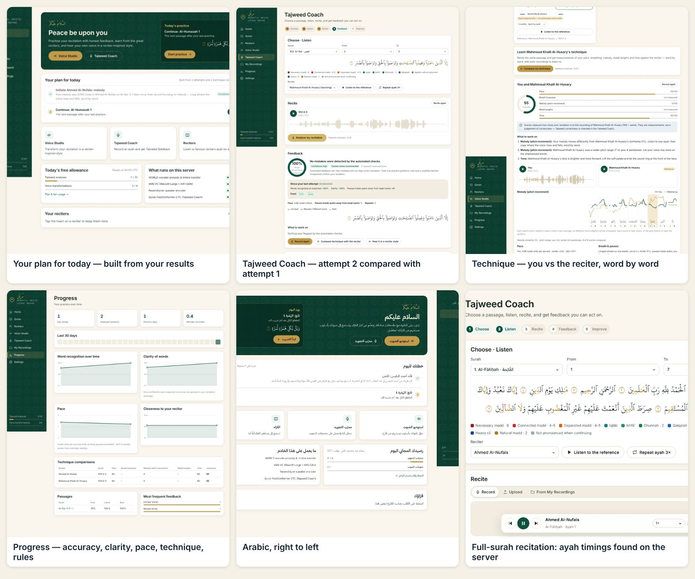

# Murattil · مُرتِّل

A Quran recitation practice app built around one goal: **help you recite better, measured on your
own voice.**

- **Tajweed Coach.** Recite an ayah range. The Quran speech recogniser aligns every word you recited to
  the text and reports missed, different and repeated words, with:
  - the exact ayah and word;
  - step-by-step corrections;
  - your word and the reference ayah to play back.

  Each new attempt is compared with your previous one: what you fixed, what is still wrong, and what is new.
- **Learn a reciter's technique.** Record the same passage as your favourite reciter (for example
  Ahmed Al-Nufais). You get word-by-word measurements of pace, breath and pauses, pitch movement
  (melody), madd lengths and tone, against the reciter reciting the same words. Both recordings can be
  played word by word.
- **Voice Studio.** Hear your own recitation transformed toward a reciter-inspired style: prosody and
  timbre transfer plus a capped neural voice blend, checked to still be your voice. It is never
  presented as the reciter's voice.
- **Your plan for today.** Built only from your own results: fix the words from your last attempt,
  drill the rule flagged most, imitate your reciter on your weakest technique score, then review or
  continue.
- **Reciters and Quran reader.** Ahmed Al-Nufais, Alafasy, Al-Sudais, Al-Muaiqly, Al-Dosari, Islam Sobhi,
  Al-Minshawi, Al-Husary, Abdul Basit and more. Play ayah by ayah with repeat, range and speed, alongside
  the KFGQPC Uthmani text with tajweed colours.

English and Arabic (RTL), light and dark, desktop and mobile. Free within published daily limits.



```
murattil/
  server/   Python: API, background jobs, audio + AI pipelines, evaluation scripts, tests
  web/      React + TypeScript single-page app
  deploy/   Hugging Face Space card (see "Put it online")
  scripts/  data build (Quran text, tajweed spans)
```

## Measured on real recitations

Every number below was measured on real human recitation, not synthetic audio. The corpus is the
public benchmark of the [Tilawa project](https://github.com/yazinsai/tilawa/tree/main/lab/benchmark):

- EveryAyah professional reciters (Alafasy, Husary and others): 204 recordings, 79 minutes.
- Crowd-sourced recitations: TLOG (77 recordings) and RetaSy (54).

To reproduce: `python server/scripts/evaluate_coach.py --corpus DIR --download` (the audio is not
redistributed here).

### Tajweed Coach: words

| | Result |
| --- | --- |
| False alarms on correct professional recitation | **2.7 % of words** flagged (78 of 2,836); 46 of 204 recordings get at least one flag |
| A word **deleted** from a professional recording | flagged at that word in **80 %** of 107 trials |
| A word **replaced** by another word of the same ayah | flagged in **84 %** of 103 trials |
| A word **repeated** | flagged in **83 %** of 107 trials |
| Speed after warm-up | median 1.3 s per recording (4 CPU cores) |

The measurement exposed a recogniser habit on long madds: it writes a held syllable twice
(«عليكمكم» for «عليكم») or splits a word in two. Word matching now forgives exactly those patterns,
which cut false alarms from 4.4 % to 2.7 % while detection stayed the same or improved.

### Tajweed Coach: rule checks

Only checks shown to be reliable on real audio are reported:

| Check | On correct professional recitation | Detects a real mistake | Reported? |
| --- | --- | --- | --- |
| Madd length (4–6 counts) | before the fix below: flagged "short" on 95 % of professional madds; re-measurement after the fix in progress | controlled shortening to ~1.5 counts (see below) | until re-measured: as information only |
| Ghunnah duration | flagged "short" on 98 % of professional ghunnahs (before the fix below) | not measurable without labelled mistakes | **no** |
| Qalqalah release | flagged "missing" on 77 % of professional qalqalahs (room reverb fills the closure) | — | **no** |
| Pause inside a word | 16 pauses in 2,836 professional words | — | yes, as information only |

Two bugs were found this way. The detector for a held vowel used a spectral-steadiness threshold
tuned on synthetic speech, which real recordings never pass. It also excluded the vowels ī and ū,
so real madds measured about 0 counts. Both are fixed: steadiness is now measured on mel bands,
relative to each recording. A controlled test supports this: the held vowel of a professional's
madd is shortened to about 1.5 counts by cutting out its middle, and the coach must notice.

### Reciter technique comparison

Each control below checks one measurement against a known change of a real professional recording,
against itself:

| Control | Result |
| --- | --- |
| Same recording | every score 100 |
| Slowed to 0.8× | measured pace ratio 0.79–0.86 |
| Pitch raised 3 semitones | melody similarity 91–97 % (melody is compared relative to each voice's own pitch); pace unchanged |

It was also run on 48 pairs of a crowd-sourced reciter and a professional reciting the same ayah. 44 were compared; 4 could not be matched word by word and were reported as such rather than scored. Examples of what it found: learners held the 6-count madd of «ٱلضَّآلِّينَ» for 0.1–0.5 s where Alafasy holds it 2.5 s; one reciter was 2.4× faster than Husary; another took mid-ayah breaths after «لَآ» and «مَا» where the reciter does not. Scores measure closeness to that recording, not correctness.

### Other measurements

- **Finding ayahs in a full-surah recording.** Some reciters, including Ahmed Al-Nufais, are published
  only as one file per surah. In 5–6 minute recordings built from real professional ayahs (half with
  the pauses removed), the found ayah overlaps the true one by 0.90 on average (worst 0.73), at about
  4 s per minute of audio.
- **Voice Studio on a real recitation.** A crowd-sourced 103:3 transformed with the neural blend:
  the identity guard measured 0.89 similarity to the user and 0.80 to the reference (passed); 91 % of
  melody frames were aligned to the reciter's recitation of the same ayah.

### End-to-end in a browser on real audio

Playwright drove Chromium. The microphone was a fake capture device playing a real crowd-sourced
recitation, and the reference reciters were real EveryAyah recordings. All 15 checks passed, with
no page errors:

- Attempt 1 (uploaded, one word cut out) reports that word as not heard, with step-by-step correction.
- Attempt 2 (recorded live through the microphone) lists the word as fixed.
- Technique comparison with Husary (per-ayah source) and with Al-Nufais (full-surah source, ayahs
  found on the server).
- The player finds ayah timings for a full-surah recording and then plays ayah by ayah.
- The plan and progress pages show what was measured.
- Arabic and mobile layouts render without horizontal scroll.

The audio hosts are blocked from the development sandbox, so they were replaced by a local stand-in
serving those real recordings. Al-Nufais's own audio could therefore not be fetched, and a
professional EveryAyah recording stood in for his full-surah file.

## What must be connected for a live deployment

| Needed | Why | Status |
| --- | --- | --- |
| A host with ≥ 4 GB RAM (2 vCPU is enough) | models run on the CPU | Docker image and a one-click Hugging Face Space workflow are included (below) |
| Outbound HTTPS to `everyayah.com` and `mp3quran.net` | reference recitations are streamed, not rehosted | Works on normal hosting. Folder names and mp3quran name matching were not checked live, because those hosts were unreachable from development. The server re-checks every source every 6 h and the UI marks unreachable ones. |
| Model weights (~1.4 GB) | Quran recogniser and kNN-VC | Downloaded during the Docker build from the authors' GitHub releases |
| A reciter's written consent | full voice conversion toward a specific reciter | **None registered.** Without consent the app uses a style-inspired transformation with the neural blend capped at 50 %, and says so. See "Authorised voice models". |
| Teacher-labelled recordings of tajweed mistakes | to validate and enable ghunnah / qalqalah checks | Not available. These checks stay off until they can be measured. |

## Put it online

**Hugging Face Spaces (free CPU tier, public https link):**

1. Create a token with *write* access at https://huggingface.co/settings/tokens.
2. In this GitHub repository, add it as an Actions secret named `HF_TOKEN`.
3. Run **Actions → Deploy Murattil to Hugging Face**, entering a Space name such as `your-name/murattil`.

The first build takes about 15–25 minutes, including the model weights. The app is then served at
`https://your-name-murattil.hf.space`.

**Any Docker host:**

```bash
docker build -t murattil murattil/
docker run -p 8000:8000 -v murattil-var:/srv/var murattil
```

The Dockerfile was not built in the development environment, because it had no Docker daemon. Its
steps are the same as the local setup below, which was used for all the tests.

## Run it locally

Requirements: Python 3.11+, Node 20+, ffmpeg.

```bash
cd server
python -m venv .venv && . .venv/bin/activate
pip install torch==2.14.1 --index-url https://download.pytorch.org/whl/cpu   # CPU build, optional but much smaller
pip install -r requirements-dev.txt
python scripts/fetch_models.py        # ~1.4 GB: kNN-VC (bshall/knn-vc releases) + Quran ASR (yazinsai/tilawa v0.2.0)

cd ../web && npm ci && npm run build   # builds web/dist, served by the API server
cd ../server && MURATTIL_SECURE_COOKIES=0 uvicorn murattil.main:app --port 8000   # http://localhost:8000
```

Notes:

- **Without the model files the app still runs.** The Coach then checks recording quality only, the
  technique comparison is unavailable, and the Studio uses signal processing only. Each says so in
  the UI.
- **Development:** `npm run dev` in `web/` proxies `/api` to port 8000.

### Configuration (environment variables)

| Variable | Default | |
| --- | --- | --- |
| `MURATTIL_VAR_DIR` | `server/var` | SQLite database, private recordings, caches |
| `MURATTIL_MODELS_DIR` | `server/models` | model weights |
| `MURATTIL_WEB_DIST` | `web/dist` | built front end |
| `MURATTIL_SECURE_COOKIES` | `1` | set `0` only for plain-http local development |
| `MURATTIL_FRAME_ANCESTORS` | unset | allow framing by these origins (e.g. `https://huggingface.co`); the session cookie becomes partitioned |
| `MURATTIL_WARM_UP` | `1` | load the recogniser at startup |
| `MURATTIL_WORKERS` / `MURATTIL_TORCH_THREADS` | `2` / `2` | background AI workers and threads per worker |
| `MURATTIL_MAX_QUEUE` | `50` | refuse new AI jobs above this queue length |
| `MURATTIL_FREE_*`, `MURATTIL_SUPPORTER_*` | see `config.py` | fair-usage limits |
| `MURATTIL_ADMIN_TOKEN` | unset | enables `POST /api/admin/reciters/health` |

## How it works

| Part | What runs |
| --- | --- |
| Tajweed Coach | Quran FastConformer CTC (Tilawa, MIT / NVIDIA CC-BY-4.0), run in overlapping 30 s chunks for long recordings. Forced alignment of the expected ayahs (basmalah optional) uses the model's own spelling where its free transcription agrees, so a word's confidence measures how well the expected word explains the audio. Text differences are matched forgivingly (see above). Thresholds are named constants in `tajweed/coach.py`, chosen with `evaluate_coach.py --rescore`. |
| Technique comparison | Both recordings are aligned word by word to the text. Measured per word and compared at the same words: articulation rate (pauses excluded), pauses where both a neural VAD and an energy detector hear silence, pitch contour relative to each speaker's median, madd vowel length, and tone (vocal-tract length, warmth, brightness). |
| Ayah boundaries in surah files | Recognition anchors the words to the text, then forced alignment block by block; boundaries are moved into the reciter's pause. Results are cached per surah. |
| Voice Studio | WORLD vocoder prosody and timbre transfer (DTW-aligned melody and timing from the same passage) plus kNN-VC (WavLM-Large + HiFi-GAN) blended at most 50 % toward the reference. A Resemblyzer identity guard must find the output closer to you than to the reciter (≥ 0.70 to you), or the blend is reduced and finally withheld. The guard fails closed. |
| Quran text | KFGQPC Uthmanic Hafs v3.0 with 147,234 tajweed spans (quran.ws, CC BY 4.0). The letter skeleton of all 6,236 ayahs was checked against Tanzil. |

How outputs are labelled:

- **"Style-inspired AI voice blend":** the neural stage ran and passed the identity check.
- **"Style-inspired transformation (signal processing — no neural voice conversion)":** the neural
  stage was off, unavailable or rejected.
- **Reference recitations:** always played separately.

Every transformed file carries a disclaimer, on screen and inside the WAV.

## Fair usage

Free plan, per account per UTC day:

- 30 analyses (Tajweed Coach and technique comparisons) and 8 voice transformations.
- Recordings up to 120 s (analysis) and 45 s (transformation).
- 300 MB of storage.

A job reserves one unit when it is queued and refunds it if it fails or is cancelled. The "Supporter"
plan has higher limits but is not for sale: there is no payment integration.

## Privacy and security

- **Accounts:** every visitor gets a private anonymous account with an http-only session cookie.
  Email and password are optional; passwords are hashed with scrypt.
- **Recordings and job results:** only ever served to their owner. Deleting a recording removes its
  files immediately, and deleting the account removes everything.
- **Requests:**
  - State-changing API calls require an `X-Requested-With` header.
  - Uploads are size-capped before they are read.
  - ffmpeg is restricted to the `pipe` protocol.
  - Server-side reference fetches go only to allow-listed HTTPS hosts, with every redirect hop checked.
- **Headers:** a strict Content-Security-Policy.

## Authorised voice models

Full conversion toward one specific person's voice is only possible for voice banks registered with
documented consent:

```bash
python -m murattil.voice.registry add --id <id> --name-en "..." --audio-dir <licensed audio> \
    --consent-document consent.pdf --granted-by "Full Name" --signed-at 2026-01-31 [--expires-at ...]
```

The manifest stores the consent document's SHA-256. A model is not loaded if its consent is missing,
expired, revoked, out of scope, or the document was altered.

## Tests

```bash
cd server
pytest                                                     # 65 tests
MURATTIL_REAL_MODELS=1 pytest tests/test_real_models.py    # 6 tests against the downloaded weights
python scripts/evaluate_coach.py --corpus DIR --download   # real-recitation evaluation (above)
python scripts/evaluate_segmentation.py --corpus DIR       # ayah boundaries in long recordings
```

## Sources and licences

- **Quran text:** KFGQPC Uthmanic Hafs v3.0, packaged by quran.ws (CC BY 4.0). Cross-check: Tanzil (CC BY 3.0).
- **Tajweed rules:** quran.ws corpus (CC BY 4.0).
- **Fonts:** KFGQPC Uthmanic Script HAFS; Amiri, IBM Plex Sans Arabic, Inter (OFL).
- **Recitations:** streamed from everyayah.com and mp3quran.net and not rehosted. Rights remain with
  the reciters and publishers.
- **Models:**
  - kNN-VC and WavLM (MIT, vendored in `server/murattil/voice/knnvc`)
  - Tilawa FastConformer (MIT / CC-BY-4.0)
  - Resemblyzer (Apache-2.0)
  - Silero VAD (MIT)
  - WORLD (modified BSD)
- **Evaluation audio:** the Tilawa benchmark (downloaded on demand). **Test fixtures:** LibriSpeech
  (CC BY 4.0) and synthetic Arabic from eSpeak NG.

## Known limitations

- **Automated feedback is not a teacher.** About 1 word in 37 of correct professional recitation is
  flagged, and about 1 real word mistake in 5 is missed. The app always says so and recommends a
  qualified teacher.
- **Few rule checks.** Ghunnah, qalqalah, makharij and sifat are not judged automatically. They are
  taught with highlighted rules, explanations and reference playback.
- **Technique scores compare you with one recording of a reciter.** They are closeness, not
  correctness.
- **The neural blend outputs 16 kHz audio**; the signal-processing path runs at 24 kHz.
